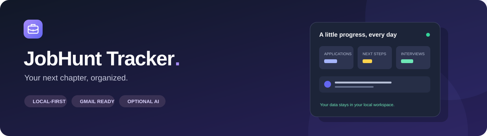
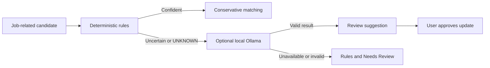

<div align="center">



### A calmer way to manage your job search.

Applications, recruiter conversations, and follow-ups in one local workspace.
Built for students applying for internships and graduate roles.

**Local SQLite** · **Gmail integration** · **Optional local AI** · **You control every email**

[Get started](#get-started) · [Connect Gmail](#connect-gmail) · [Local AI](#optional-local-ai) · [Privacy](#privacy-and-control) · [Development](#development)

</div>

---

> **Nothing sends automatically.** Review suggestions, optionally create a Gmail draft, and send it yourself in Gmail.

## Your search, at a glance

| Stay organized                         | Keep conversations together     | Know your next move                  |
| -------------------------------------- | ------------------------------- | ------------------------------------ |
| Dashboard and recent activity          | Relevant Gmail timeline         | Follow-up reminders                  |
| Application table and Kanban           | Recruiter contacts and outreach | Interview and assessment alerts      |
| Search, filters, and CSV import/export | Review uncertain matches        | Concise, editable email suggestions  |
| Dark mode and mobile navigation        | Duplicate detection             | Optional local Ollama classification |

Track **Interested → Applied → Awaiting reply → Assessment → Interview → Offer**, plus recruiter outreach, rejections, and withdrawals.

## Get started

Install Node.js 24 LTS (22.18+ also works). No Docker or external database is required. In Windows PowerShell, from the cloned project folder:

```powershell
npm install
Copy-Item .env.example .env
npm run db:generate
npm run db:push
npm run dev
```

Open **[localhost:3000/dashboard](http://localhost:3000/dashboard)**. Start with an empty tracker; Gmail and AI are optional.

Keep an existing configured `.env` instead of copying over it. If PowerShell blocks `npm.ps1`, use `npm.cmd` for the commands above. The server binds to `127.0.0.1`; this is a single-user app intended to stay on your computer.

<details>
<summary><strong>Try fictional example data</strong></summary>

```powershell
npm run db:seed
```

Examples cover Proximus, KBC, Deloitte, Microsoft, and Accenture, with invented contacts and `.example` email addresses. Seeding is idempotent and does not delete existing records.

To preview and remove only recognized demo records:

```powershell
node scripts/remove-demo-data.mjs
node scripts/remove-demo-data.mjs --apply
```

The cleanup preserves real records and connection settings. Real messages linked to demo applications return to review.

</details>

## Connect Gmail

1. Create a project in [Google Cloud Console](https://console.cloud.google.com/) and enable **Gmail API**.
2. Configure **Google Auth Platform** branding and audience. During Testing, add your Gmail address as a test user.
3. Add the `https://www.googleapis.com/auth/gmail.readonly` scope. Optional drafts additionally require `https://www.googleapis.com/auth/gmail.compose`.
4. Create a **Web application** OAuth client. Set its redirect URI exactly to `http://localhost:3000/api/google/callback`.
5. Fill in your local `.env`, using a fresh encryption key:

```powershell
node -e "console.log(require('crypto').randomBytes(32).toString('hex'))"
```

```dotenv
DATABASE_URL="file:./dev.db"
APP_URL="http://localhost:3000"
GOOGLE_CLIENT_ID="your-client-id.apps.googleusercontent.com"
GOOGLE_CLIENT_SECRET="your-client-secret"
TOKEN_ENCRYPTION_KEY="paste-the-64-character-hex-key"
```

6. Restart the server. In **Settings**, select **Connect Gmail · read-only**, then open **Job inbox → Sync Gmail**.
7. If you want drafts, explicitly select **Enable optional Gmail drafts** and approve the additional scope.

`gmail.compose` is Google's standalone scope for creating drafts and also permits sending at the permission level. This application implements draft creation only; it has no email-send endpoint. Draft creation requires a click and does not complete a reminder or change contact dates.

<details>
<summary><strong>Connection troubleshooting</strong></summary>

| Problem                      | Check                                             |
| ---------------------------- | ------------------------------------------------- |
| Redirect mismatch            | Exact callback URI, host, port, and `APP_URL`     |
| Access denied during Testing | Your account is listed as a test user             |
| Authorization expired        | Reconnect; testing-mode refresh tokens can expire |
| University account blocked   | Your administrator's OAuth policy                 |
| Changed credentials          | Restart the server after editing `.env`           |

Personal development uses your test-user account. Distributing the app with restricted Gmail scopes may require Google verification. See [OAuth setup](https://developers.google.com/identity/protocols/oauth2/web-server), [Gmail scopes](https://developers.google.com/workspace/gmail/api/auth/scopes), and [draft creation](https://developers.google.com/workspace/gmail/api/reference/rest/v1/users.drafts/create).

</details>

## Optional local AI

Install [Ollama for Windows](https://ollama.com/download/windows), then download the default model:

```powershell
ollama pull qwen2.5:3b
```

For local-only Ollama operation, quit any background Ollama instance, then start it in a separate PowerShell window:

```powershell
$env:OLLAMA_NO_CLOUD = "1"
ollama serve
```

You can also set `OLLAMA_NO_CLOUD=1` as a user environment variable and restart Ollama. See [Ollama's local-only configuration](https://docs.ollama.com/faq#how-do-i-disable-ollama-cloud-features).

In **Settings → Local AI email classification**, enable AI, test the connection, and save.

| Setting              | Default                          |
| -------------------- | -------------------------------- |
| Enable local AI      | Off                              |
| Ollama URL           | `http://localhost:11434`         |
| Model                | `qwen2.5:3b`                     |
| Confidence threshold | `0.70` (can be raised to `1.00`) |



The model receives **only sender, subject, and the cleaned current email body**, capped at 12,000 characters. No unrelated thread history, attachments, application database, or OAuth tokens are included. Bodies are cleaned in memory and are not persisted.

Only HTTP loopback addresses are accepted. Requests bypass proxies, never follow redirects, and reject cloud-backed model metadata. No cloud AI provider is used, and the app never downloads models automatically.

Results below `0.70` (or your higher threshold) become **Needs Review** and cannot automatically change an application. Higher-confidence AI results remain suggestions that require **Confirm match & status**. Existing cached messages are not silently reclassified when AI is enabled.

If Ollama is unavailable, a model is missing, or the response is malformed, the tracker falls back to deterministic rules and keeps uncertain messages for review. Connection checks time out after 5 seconds; classification requests after 60 seconds. An unavailable server is skipped for the remainder of that sync page.

<details>
<summary><strong>Structured classification output</strong></summary>

Output uses a JSON schema and is validated again with Zod:

```json
{
  "isJobRelated": true,
  "company": "Example Company",
  "role": "Example Internship",
  "status": "INTERVIEW",
  "confidence": 0.92,
  "reason": "The message invites the applicant to an interview."
}
```

Allowed statuses: `APPLICATION_CONFIRMATION`, `RECRUITER_REPLY`, `INTERVIEW`, `ASSESSMENT`, `REJECTION`, `OFFER`, `FOLLOW_UP`, and `UNKNOWN`. Email text is treated as untrusted data; no model tools are exposed.

</details>

## How tracking works

**Focused sync.** Search recruiting phrases and ATS senders including Workday, Greenhouse, Lever, SmartRecruiters, and Taleo. Initial sync covers 90 days; later complete syncs overlap seven days. Each click processes up to 100 candidates; **Sync next page** continues. Spam and trash are excluded. Sync is explicit, not scheduled.

**Conservative matching.** Confirmed threads, reference IDs, company/domain, role, and contacts help match messages. Automatic matching needs at least 85% confidence and a clear lead over alternatives. Classification confidence is checked separately. Ambiguous matches require approval; emails never automatically create applications. If needed, create an application first, then confirm the match in the inbox.

**Useful reminders.** Formal applications suggest a follow-up after seven calendar days; recruiter outreach after five business days, excluding weekends. Public holidays are not modeled. Manual due dates are supported. Replies, assessments, interviews, offers, rejections, and withdrawals stop reminders. Older messages cannot undo newer progress.

**You control outreach.** Suggestions use known contact, company, role, and signature information. Edit or copy them, or explicitly create a new Gmail draft. Send in Gmail, then select **I sent a follow-up myself** to record it. Drafts do not automatically reply into an existing thread.

**Portable records.** CSV export includes tracking fields and escapes spreadsheet formulas. Import requires `company` and `jobTitle`, accepts up to 500 rows / 2 MB, validates rows, and skips duplicates. Use `YYYY-MM-DD` dates, exact UI status names, and type `Application` or `Recruiter outreach`. Create contacts first to link imported recruiter email addresses. An empty export provides a header template.

## Privacy and control

| Information                                | Where it lives                       |
| ------------------------------------------ | ------------------------------------ |
| Applications, contacts, settings           | Local SQLite under `prisma/`         |
| OAuth tokens                               | Encrypted locally using AES-256-GCM  |
| Relevant email metadata and short snippets | Local SQLite                         |
| Cleaned email body for AI                  | Memory and your local Ollama process |
| Optional drafts                            | Gmail, after your explicit action    |

No Google password is collected. OAuth uses state validation, a short-lived HttpOnly cookie, and PKCE. Routes enforce localhost access; mutations check origin and host. Protect your computer and encryption key: encryption does not prevent access by someone controlling your machine.

**Disconnect & delete cached mail** removes local tokens, email cache, draft references, and email-derived notifications while retaining applications, contacts, and manual tracking. Existing drafts remain in Gmail. Disconnect before rotating the encryption key. If Google revocation cannot be confirmed, remove access in your Google Account settings.

Share the source, not your local workspace. `.gitignore` excludes credentials, databases, backups, CSV exports, auth-state files, logs, and test artifacts. Only the empty `.env.example` belongs in Git. Review staged files before publishing; ignore rules do not remove files already committed. Avoid publishing screenshots containing real email or account details.

## Development

Built with **Next.js · TypeScript · Tailwind CSS · shadcn/ui-style components · Prisma · SQLite**.

| Page                 | Purpose                                          |
| -------------------- | ------------------------------------------------ |
| `/dashboard`         | Overview, recent activity, needs attention       |
| `/applications`      | Table, Kanban, search, filters, CSV              |
| `/applications/[id]` | Editable application and relevant email timeline |
| `/contacts`          | Recruiter relationships and outreach             |
| `/inbox`             | Sync, notifications, match review                |
| `/follow-ups`        | Due reminders and editable suggestions           |
| `/settings`          | Profile, theme, Gmail, local AI                  |

```powershell
npm run lint
npm run typecheck
npm test
npm run build
npm start
```

Optional browser tests use a separate `prisma/e2e.db` and port 3011. Stop a development server for this same project before running them:

```powershell
npx playwright install chromium
npm run test:e2e
```

Tests cover classification, matching, follow-up dates, duplicates, draft approval, Ollama success/failure, malformed JSON, confidence gating, body cleaning, loopback restrictions, and cloud-model rejection. Browser tests cover workspace pages, dark mode, mobile navigation, forms, CSV, and origin protection. Gmail and live model inference require your own local configuration; tests use isolated fixtures and mock Ollama servers.

<details>
<summary><strong>Project map</strong></summary>

```text
docs/                 Branding artwork
prisma/               Schema and optional fictional seed
src/app/              Pages, server actions, API routes
src/components/       Navigation and UI components
src/lib/domain.ts     Rules, matching, duplicates, follow-up arithmetic
src/lib/google.ts     OAuth, encrypted tokens, Gmail requests
src/lib/mail-sync.ts  Bounded sync and conservative updates
src/lib/local-ai.ts   Local Ollama classification and transport
src/lib/ai-config.ts  Validated AI settings and output
src/lib/email-body.ts Current-message extraction and cleaning
tests/                Unit and integration tests
e2e/                  Isolated browser tests
.env.example          Empty configuration template
```

Models: `Application`, `Company`, `Contact`, `EmailMessage`, `EmailThread`, `FollowUp`, `Activity`, and `UserSettings`.

</details>

<details>
<summary><strong>Dependency audit notes</strong></summary>

Production dependencies passed `npm audit --omit=dev` during verification. The full development graph reported five high-severity advisories inherited through Next.js lint tooling (`braces`), with no patched release available at that check. Avoid incompatible toolchain downgrades through `npm audit fix --force`; recheck advisories as dependencies evolve.

</details>

---

<div align="center">

**Small steps. Clear next moves. Your next chapter.**

</div>
